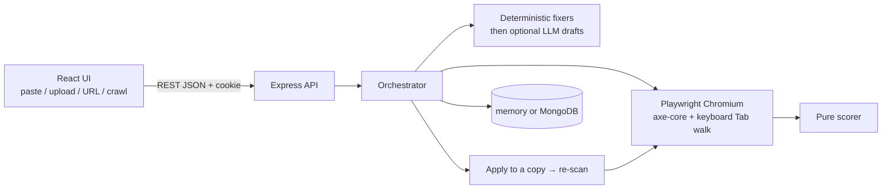

# AccessFix

> Accessibility auditing that ships verified source fixes, not overlays.

Paste HTML, upload a small site, scan a public URL, or crawl one host. AccessFix finds WCAG 2.2
AA issues in plain language, applies **real source fixes** in an isolated preview, and verifies
the before/after result. The deterministic workflow works with the LLM turned off.

Hackathon problem statement PS 11: "Web Accessibility Auditor + Fix-Suggester".

> **Status: demo-ready.** The app includes accounts, private scans, share links, the results
> workbench, optional AI drafts, and verified repairs. Quotas are off unless
> `QUOTAS_ENABLED=true`. The default memory store is convenient for local development; MongoDB
> is available for persistence. See [`project.md`](project.md) for the full product map.

## Quick start

Requirements:

- Node 20.11+ and npm 10+ (see [`.nvmrc`](.nvmrc))
- Chromium, installed by Playwright for scans and browser tests

From PowerShell:

```powershell
npm install
Copy-Item .env.example .env       # optional; defaults are safe for local development
npm run browsers:install          # one-time Playwright Chromium download
npm run dev                       # API:4000 and web:5173
```

Open [http://localhost:5173](http://localhost:5173). The header should say **API online**.
Select **Try the broken sample** to scan [`samples/broken-sample.html`](samples/broken-sample.html),
then choose **Suggest fixes** and **Apply verified fixes**. The score should rise while
placeholder values, such as image alt text, remain for manual completion.

Check the API independently at [http://localhost:4000/health](http://localhost:4000/health).
The optional smoke test checks health, a scan, and a report:

```powershell
npm run smoke -- http://localhost:4000
```

### Local URL scanning

To scan a local site, set `ALLOW_PRIVATE_URLS=true` in `.env` and restart the API. This is
development-only: production configuration rejects it, and the UI displays a warning badge
while private URL scanning is enabled.

## Common workflows

| Goal                        | Command                           |
| --------------------------- | --------------------------------- |
| Start API and frontend      | `npm run dev`                     |
| Run all tests               | `npm test`                        |
| Run fast backend tests      | `npm run test:unit -w backend`    |
| Run browser tests           | `npm run test:browser -w backend` |
| Build the frontend          | `npm run build`                   |
| Lint the repository         | `npm run lint`                    |
| Check formatting            | `npm run format:check`            |
| Run Mongo integration tests | `npm run test:mongo`              |
| Install Playwright Chromium | `npm run browsers:install`        |

Scripts run from the repository root:

| Script                            | What it does                                                                        |
| --------------------------------- | ----------------------------------------------------------------------------------- |
| `npm run dev`                     | API (node --watch) and web (Vite) together                                          |
| `npm test`                        | Vitest in both workspaces (browser tests skip loudly if Chromium is missing)        |
| `npm run test:browser -w backend` | Only the real-Chromium suites                                                       |
| `npm run test:unit -w backend`    | Only the fast backend unit tests                                                    |
| `npm run lint`                    | ESLint 9 (flat config, `jsx-a11y` strict on the frontend)                           |
| `npm run format` / `format:check` | Prettier                                                                            |
| `npm run build`                   | Production build of the frontend                                                    |
| `npm run test:mongo`              | Mongo repository contract and persistence tests (needs local Mongo for integration) |
| `npm run smoke -- <api-url>`      | Health check, one scan, and one report against a running API                        |
| `npm run browsers:install`        | Download Playwright Chromium                                                        |

Deployment steps and the Render setup are in [`docs/10-deploy.md`](docs/10-deploy.md). The current audit, screenshots, and deferred items are in [`docs/15-ui-audit.md`](docs/15-ui-audit.md).

## Configuration

The app starts without a `.env` file. Copy [`.env.example`](.env.example) when you need to
override defaults. The most useful local settings are:

```dotenv
# Enable local/private URL scanning during development
ALLOW_PRIVATE_URLS=true

# Persist accounts and scans in MongoDB instead of process memory
STORE=mongo
MONGODB_URI=mongodb://127.0.0.1:27017/accessfix

# Optional AI-generated wording drafts; deterministic fixes still work without this
LLM_PROVIDER=openai-compatible
LLM_API_KEY=replace-me
LLM_MODEL_CHEAP=replace-me
```

For MongoDB locally:

```powershell
docker compose up -d mongo
```

Leave `REDIS_URL` empty and `QUOTAS_ENABLED` false unless you specifically want quota
enforcement. See [`docs/10-deploy.md`](docs/10-deploy.md) for deployment configuration and
[`docs/04-api-contract.md`](docs/04-api-contract.md) for the API surface.

## Troubleshooting

- **API offline:** confirm port 4000 is free and inspect the terminal running `npm run dev`.
- **Chromium missing:** run `npm run browsers:install`, then restart the API.
- **Mongo errors:** either start MongoDB and set `STORE=mongo`, or remove that setting to use
  the default memory store.
- **Frontend cannot reach the API:** run both services through `npm run dev`; Vite uses port
  5173 and the API uses port 4000 by default.

## How a scan works



1. **Input.** Paste HTML, upload an `.html` file plus `.css` files (the browser inlines the CSS, then the 5 MB cap applies), or scan a public URL. Signed-in accounts can crawl one host (breadth-first, robots.txt, default 10 pages / depth 2 while quotas are off).
2. **Render.** Isolated Chromium. Public stylesheets and images load; private addresses are blocked. A Tab walk (up to 50 stops) is recorded as hints, not axe violations.
3. **Check.** axe-core WCAG 2.2 A/AA plus our heading/keyboard checks. Results include failed rules, passed rules (for the Checks table), and “check by hand” items. Color-contrast evidence is stored only when both colors were measured.
4. **Explain.** Each issue card says what is broken, who it affects, why it matters, and how we fix it. Marks on the screenshot stay in reading order.
5. **Repair.** Suggest fixes runs deterministic patches first. The LLM, if on, only drafts wording. Nothing is applied until you accept drafts and click Apply verified fixes.
6. **Verify.** The patched copy is re-scanned. A fix is verified only if that issue is gone and nothing else broke. Then you can copy or download the patched HTML, or a ZIP of original + patched pages (up to 20 MB).

The score is automated checks only. It is not a WCAG conformance claim.

## Accounts, plans and quotas

Auth is real: `POST /signup` (201) and `POST /login` (200) set an HttpOnly `accessfix.sid` cookie. Mutating calls send `x-accessfix-request: 1`. There is no password reset.

|                 | Signed out | Free                                          | Pro                        |
| --------------- | ---------- | --------------------------------------------- | -------------------------- |
| Scans / UTC day | 100        | 30                                            | 300                        |
| Pages / day     | —          | 100                                           | 1,000                      |
| AI tokens / day | —          | 50,000                                        | 300,000                    |
| Pages / crawl   | —          | 5 when quotas on, else `CRAWL_MAX_PAGES` (10) | 10 when quotas on, else 10 |

Quotas are **off** unless `QUOTAS_ENABLED=true`. Commands (also listed on `/business`):

```bash
# .env — turn limits on
QUOTAS_ENABLED=true

# .env — these emails become Pro on the next sign-in (works with the memory store)
PRO_EMAILS=owner@example.com

# Mongo only — change an existing account
npm run plan:pro -- user@example.com pro
npm run plan:pro -- user@example.com free
```

## Persistence and the LLM

```bash
# Mongo (optional). Default STORE=memory is wiped when the API restarts.
docker compose up -d mongo
# .env
STORE=mongo
MONGODB_URI=mongodb://127.0.0.1:27017/accessfix

# LLM (optional). Off = rule-based fixes still work.
LLM_PROVIDER=openai-compatible
LLM_API_KEY=...
LLM_MODEL_CHEAP=...
```

Leave `REDIS_URL` empty. Leave `QUOTAS_ENABLED` false unless you want the table above enforced. `ALLOW_PRIVATE_URLS=true` is dev-only (the API refuses it in production).

## Layout

```
.
├── docs/                      product, business, architecture, contracts (read first)
├── backend/
│   ├── src/
│   │   ├── app.js             createApp(config, overrides): DI root, middleware, routes
│   │   ├── server.js          process entry
│   │   ├── config/env.js      Zod-validated config, safe defaults
│   │   ├── routes/            route table mirroring docs/04-api-contract.md
│   │   ├── controllers/       thin HTTP adapters -> orchestrator
│   │   ├── middleware/        validate (Zod), rate limit, timeout, error envelope
│   │   ├── schemas/           Zod contracts: Violation, Repair, VerificationResult, Score, TokenUsage, Scan
│   │   ├── services/
│   │   │   ├── orchestrator/  sequences scan -> repair -> verify
│   │   │   ├── scanner/       Playwright + axe-core (+ checks/ for our own rules)
│   │   │   ├── repair/        repair engine (+ rules/ one fixer per axe rule)
│   │   │   ├── verifier/      apply to copy, re-scan, diff
│   │   │   ├── scorer/        pure score function
│   │   │   └── llm/           provider interface (none | openai-compatible | mock)
│   │   ├── repositories/      ScanRepository contract, memory + Mongo adapters
│   │   └── utils/             errors, logger
│   └── tests/                 Vitest + Supertest (fixtures/ for rule HTML)
└── frontend/
    ├── components.json        shadcn/ui config (JavaScript)
    └── src/
        ├── App.jsx            shell: skip link, header, main
        ├── components/        ApiStatus (+ shadcn ui/ as added)
        ├── lib/               api client, contrast math, cn()
        └── styles/tokens.js   design tokens (source of truth, contrast-tested)
```

## Principles (short version)

1. Every issue ends in a patch or an honest "needs manual review".
2. We change source markup and CSS; we never inject runtime widgets.
3. Deterministic fixes first; the LLM only drafts words.
4. Token cost is tracked, budgeted and shown.
5. Detection comes only from axe-core and our own deterministic checks.
6. A fix is "verified" only after a re-scan shows the violation gone and nothing regressed.
7. The product works with the LLM turned off.

The score covers automated checks only. It is not a WCAG conformance claim. See
[docs/06-scoring-spec.md](docs/06-scoring-spec.md).

See [docs/03-architecture.md](docs/03-architecture.md), [docs/10-deploy.md](docs/10-deploy.md), [docs/11-demo-script.md](docs/11-demo-script.md), and [docs/12-phase-b.md](docs/12-phase-b.md).
