# UI screenshot gallery

The final master-polish audit captures are in [master-audit/after](master-audit/after/); the corresponding pre-polish captures are in [master-audit/before](master-audit/before/). Audit findings and deferred acceptance items are listed in [docs/15-ui-audit.md](../15-ui-audit.md).

| Master polish state | Light | Dark |
| --- | --- | --- |
| Landing 1280 / 768 / 375 | [1280](master-audit/after/landing/light/1280.png) · [768](master-audit/after/landing/light/768.png) · [375](master-audit/after/landing/light/375.png) | [1280](master-audit/after/landing/dark/1280.png) · [768](master-audit/after/landing/dark/768.png) · [375](master-audit/after/landing/dark/375.png) |
| Results 1280 / 768 / 375 | [1280](master-audit/after/results/light/1280.png) · [768](master-audit/after/results/light/768.png) · [375](master-audit/after/results/light/375.png) | [1280](master-audit/after/results/dark/1280.png) · [768](master-audit/after/results/dark/768.png) · [375](master-audit/after/results/dark/375.png) |
| Full screen after Apply 1280 / 768 / 375 | — | [1280](master-audit/after/fullscreen/dark/1280.png) · [768](master-audit/after/fullscreen/dark/768.png) · [375](master-audit/after/fullscreen/dark/375.png) |
| Color simulation, inline / full screen | [inline](master-audit/after/colors/light/protanopia.png) · [full screen](master-audit/after/colors/light/fullscreen-protanopia.png) | [inline](master-audit/after/colors/dark/protanopia.png) · [full screen](master-audit/after/colors/dark/fullscreen-protanopia.png) |

Screenshots are full-page captures at the named CSS viewport width. The app still opens in System mode by default. Dark mode is used here to compare directly with the supplied dark reference PNGs.

## Checkpoint 1: foundations, shell, landing page

The after captures have no document-level horizontal overflow at 1280, 768, or 375 CSS pixels. The comparison table scrolls inside its own frame on narrow screens.

| Width   | Before                                                 | After                                                |
| ------- | ------------------------------------------------------ | ---------------------------------------------------- |
| 1280 px | 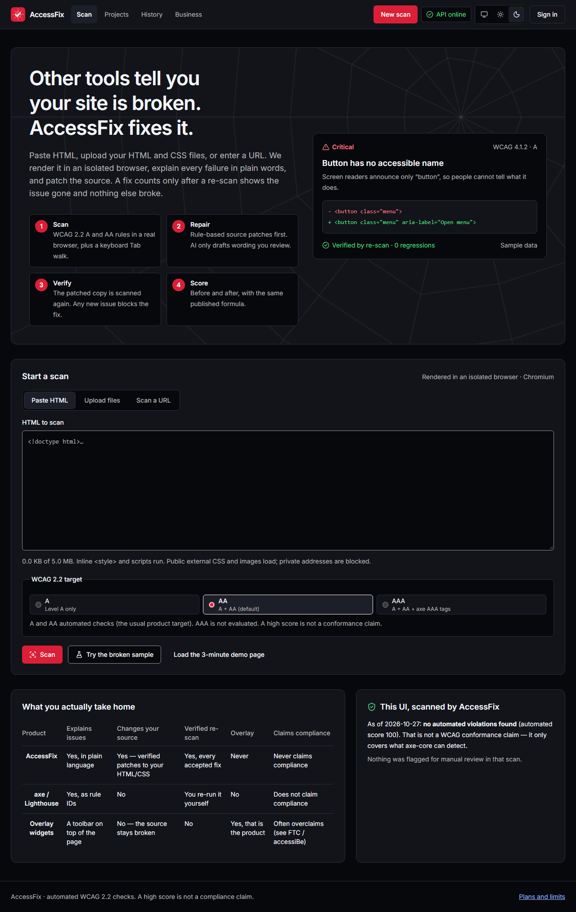 | 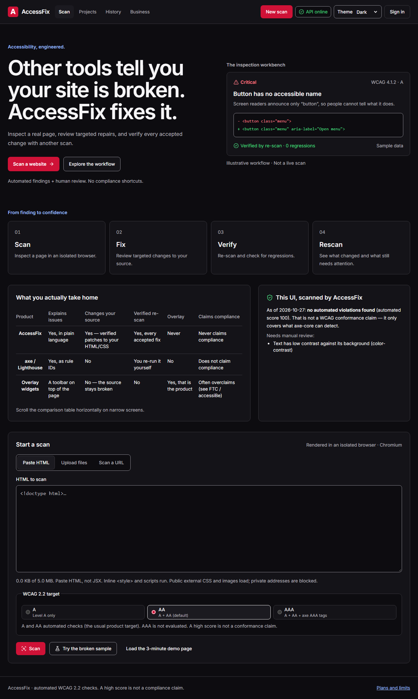 |
| 768 px  | 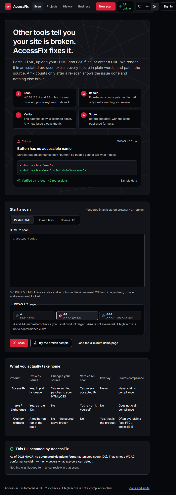   | 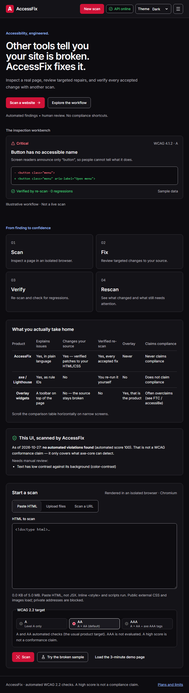   |
| 375 px  | 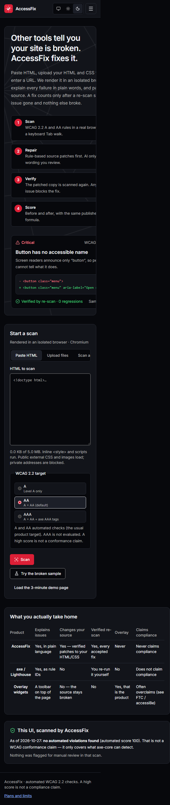   | 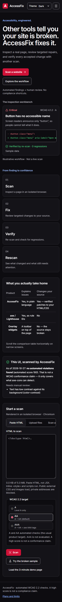   |

Viewport crops: [1280 × 900](checkpoint-1/after/1280-viewport.png), [768 × 900](checkpoint-1/after/768-viewport.png), [375 × 812](checkpoint-1/after/375-viewport.png).

## Checkpoint 2: workspace and results readability

The after captures are from the bundled broken-sample scan in dark mode. The page has no document-level horizontal overflow at 1280, 768, or 375 CSS pixels. A report-results baseline was not captured before this checkpoint began, so these captures show the completed state only.

| Width   | Full-page after                                        | Viewport after                                     |
| ------- | ------------------------------------------------------ | -------------------------------------------------- |
| 1280 px | 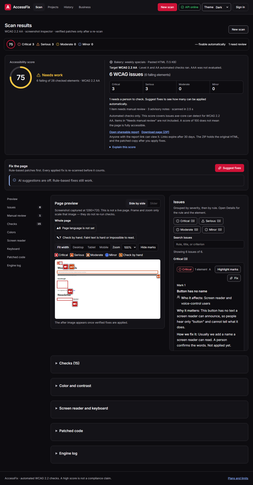 | [1280 × 900](checkpoint-2/after/1280-viewport.png) |
| 768 px  | 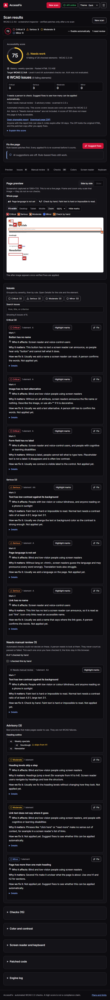   | [768 × 900](checkpoint-2/after/768-viewport.png)   |
| 375 px  | 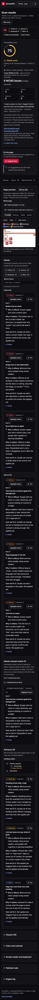   | [375 × 812](checkpoint-2/after/375-viewport.png)   |

## Checkpoint 3: full-screen comparison

The before captures show the sample scan with verified fixes ready to apply. The after captures
show the full-screen comparison after Apply. They use the same 1280 × 720 capture at each responsive
CSS viewport; full-page capture is future work. The browser run covered keyboard and pointer slider
movement, four display modes, zoom, issue navigation, the phone issue drawer, Escape, and focus return.

| Width   | Before                                                 | After                                                  |
| ------- | ------------------------------------------------------ | ------------------------------------------------------ |
| 1280 px | 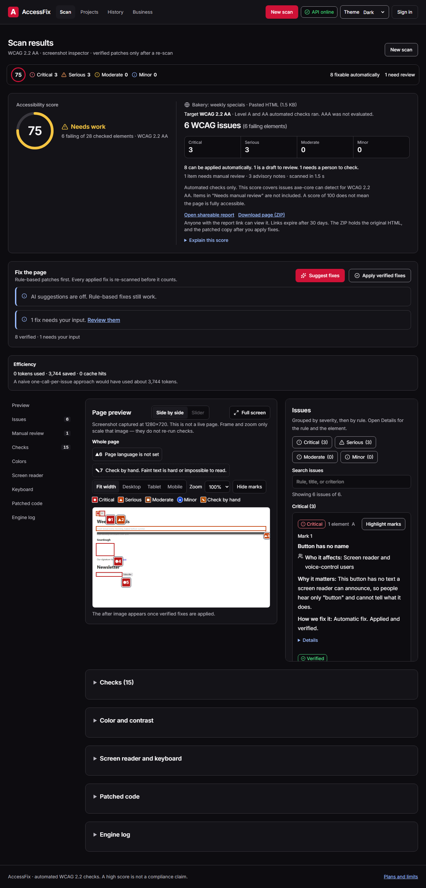 | 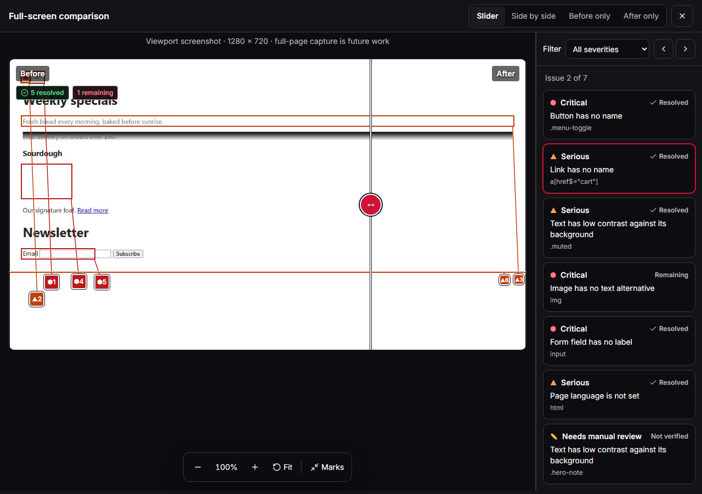 |
| 768 px  |    | 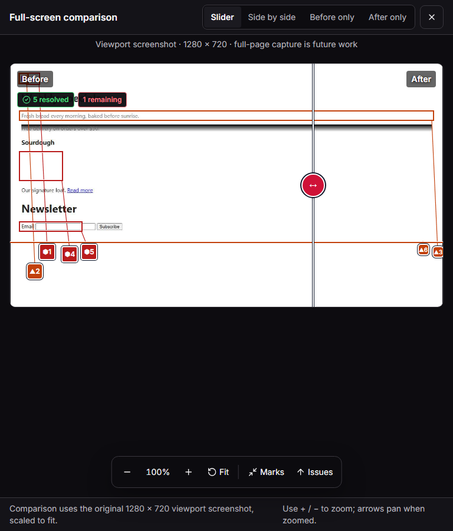   |
| 375 px  |    | 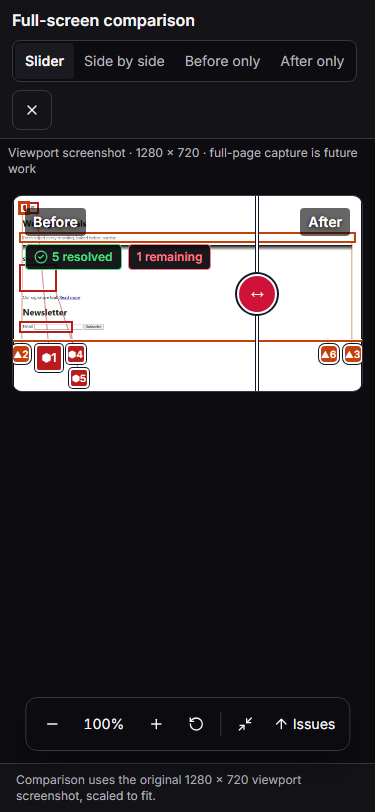   |

The full-screen e2e also covers the light theme at 1280 px, the phone issue drawer, and the patched
HTML download. The browser run reported no page errors, unhandled failed requests, or remote CDN
requests. The bundled local Monaco editor also mounted in the demo flow. [Light comparison](checkpoint-3/after/1280-light.png) · [375 px issue drawer](checkpoint-3/after/375-issues.png).

## Checkpoint 4: remaining pages and QA

The route captures cover the landing page, History, Business, login, sign-up, Projects, an expired
report, an expired share view, and the 404 page. Each route has light and dark captures at all three
widths. The report and share captures deliberately show the honest expired/missing state rather than
fabricated report data.

| Page              | Desktop light / dark                                                                                                                                                                                                                                            | Tablet light / dark                                                                                       | Phone light / dark                                                                                        |
| ----------------- | --------------------------------------------------------------------------------------------------------------------------------------------------------------------------------------------------------------------------------------------------------------- | --------------------------------------------------------------------------------------------------------- | --------------------------------------------------------------------------------------------------------- |
| Landing           | [1280 light](checkpoint-4/landing/light/1280.png) / [dark](checkpoint-4/landing/dark/1280.png)                                                                                                                                                                  | [768 light](checkpoint-4/landing/light/768.png) / [dark](checkpoint-4/landing/dark/768.png)               | [375 light](checkpoint-4/landing/light/375.png) / [dark](checkpoint-4/landing/dark/375.png)               |
| History           | [1280 light](checkpoint-4/history/light/1280.png) / [dark](checkpoint-4/history/dark/1280.png)                                                                                                                                                                  | [768 light](checkpoint-4/history/light/768.png) / [dark](checkpoint-4/history/dark/768.png)               | [375 light](checkpoint-4/history/light/375.png) / [dark](checkpoint-4/history/dark/375.png)               |
| Business          | [1280 light](checkpoint-4/business/light/1280.png) / [dark](checkpoint-4/business/dark/1280.png)                                                                                                                                                                | [768 light](checkpoint-4/business/light/768.png) / [dark](checkpoint-4/business/dark/768.png)             | [375 light](checkpoint-4/business/light/375.png) / [dark](checkpoint-4/business/dark/375.png)             |
| Login             | [1280 light](checkpoint-4/login/light/1280.png) / [dark](checkpoint-4/login/dark/1280.png)                                                                                                                                                                      | [768 light](checkpoint-4/login/light/768.png) / [dark](checkpoint-4/login/dark/768.png)                   | [375 light](checkpoint-4/login/light/375.png) / [dark](checkpoint-4/login/dark/375.png)                   |
| Sign-up           | [1280 light](checkpoint-4/signup/light/1280.png) / [dark](checkpoint-4/signup/dark/1280.png)                                                                                                                                                                    | [768 light](checkpoint-4/signup/light/768.png) / [dark](checkpoint-4/signup/dark/768.png)                 | [375 light](checkpoint-4/signup/light/375.png) / [dark](checkpoint-4/signup/dark/375.png)                 |
| Projects          | [1280 light](checkpoint-4/projects/light/1280.png) / [dark](checkpoint-4/projects/dark/1280.png)                                                                                                                                                                | [768 light](checkpoint-4/projects/light/768.png) / [dark](checkpoint-4/projects/dark/768.png)             | [375 light](checkpoint-4/projects/light/375.png) / [dark](checkpoint-4/projects/dark/375.png)             |
| Report            | [Completed 1280 light](checkpoint-4/report-completed/light/1280.png) · [print layout](checkpoint-4/report-completed/light/print.png) · [unavailable 1280 light](checkpoint-4/report-expired/light/1280.png) / [dark](checkpoint-4/report-expired/dark/1280.png) | [768 light](checkpoint-4/report-expired/light/768.png) / [dark](checkpoint-4/report-expired/dark/768.png) | [375 light](checkpoint-4/report-expired/light/375.png) / [dark](checkpoint-4/report-expired/dark/375.png) |
| Share unavailable | [1280 light](checkpoint-4/share-expired/light/1280.png) / [dark](checkpoint-4/share-expired/dark/1280.png)                                                                                                                                                      | [768 light](checkpoint-4/share-expired/light/768.png) / [dark](checkpoint-4/share-expired/dark/768.png)   | [375 light](checkpoint-4/share-expired/light/375.png) / [dark](checkpoint-4/share-expired/dark/375.png)   |
| Not found         | [1280 light](checkpoint-4/not-found/light/1280.png) / [dark](checkpoint-4/not-found/dark/1280.png)                                                                                                                                                              | [768 light](checkpoint-4/not-found/light/768.png) / [dark](checkpoint-4/not-found/dark/768.png)           | [375 light](checkpoint-4/not-found/light/375.png) / [dark](checkpoint-4/not-found/dark/375.png)           |

All captures had no document-level horizontal overflow. The expanded AccessFix self-scan ran these
nine routes in both themes and recorded zero automated violations. The pricing table retains its
“Quotas off: limits are shown, not enforced” note. Its tables scroll inside their own frames at phone
width.

The long-results run scanned a page that produced 72 issue rows. The 1280, 640 (the CSS viewport
equivalent to 200% zoom on a 1280px display), and 375px layouts all stayed within the viewport:
[1280px](checkpoint-4/long-results/dark/1280.png) ·
[640px](checkpoint-4/long-results/dark/640.png) ·
[375px](checkpoint-4/long-results/dark/375.png).
